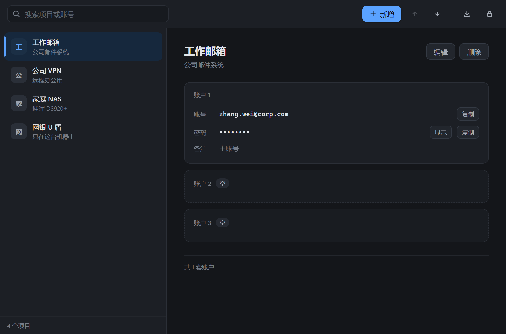

# SecBack

本地密码本，使用原生 HTML/CSS/JavaScript 和 Tauri 2，共享 Rust 核心。当前版本 0.1.1，界面中文，无服务端、账号注册或自动同步。

## 当前能力

Windows 桌面和 Android 均支持建库、项目与三套账户编辑、搜索、排序、复制、修改主密码、恢复码、加密备份导出和外部密库导入预览与合并。详见 [能力与限制](docs/能力与限制.md)。

- 加密：PBKDF2-HMAC-SHA256（新库默认 200000 轮）和 AES-256-GCM。
- 格式：v1 为 64 字节头，v2 为 256 字节头，格式布局及兼容范围见 [格式契约](docs/SecBack_格式契约.md)。
- 锁定：闲置默认 5 分钟；Android 离开到后台时锁定，系统文件选择期间暂时保留导出会话。
- 界面快照不含密码；查看详情和编辑时会临时取得明文，关闭、保存或锁定时清理引用。JavaScript 不能保证 GC 内存物理归零。
- 每次成功替换文件前保留最近三份加密版本备份，检测文件变化并拒绝过期模型覆盖。
- 恢复码可解决忘记主密码；密库文件遗失仍需要独立备份。两种措施请同时准备。

## 目录

| 路径 | 用途 |
|---|---|
| core/ | 格式、加密、读写和合并 |
| src/ | 原生前端，无前端构建步骤 |
| src-tauri/ | Tauri 宿主、Android 工程 |
| scripts/ | 版本检查、Windows/Android 发布及产物校验 |
| tests/ | 桌面 WebView 回归与规模测量 |
| docs/ | 用户说明、维护记录和格式契约 |

## 构建与验证

需要 Node.js 24、Rust 1.90 或更新版本；Windows 还需 MSVC、WebView2。Android 需要 JDK 21、SDK/NDK 和发布签名配置。版本锁定安装使用 npm ci 和 cargo --locked，具体命令见 [构建与验证](docs/构建与验证.md)。

桌面：`npm ci` 后执行 `npm run build:windows`，交付文件自动命名为 `delivery/SecBack-<version>-Windows-x64.exe`。

Android：`npm run build:android`。脚本先完成原生编译，再复制对应 .so、打包、核对 ABI/签名/原生库哈希，交付 `delivery/android/SecBack-<version>-Android-arm64.apk` 与 manifest。以后发布时更新产品版本并递增 package.json 中的 androidVersionCode。

## 数据位置与备份

Windows：SECBACK_VAULT 环境变量 → exe 同目录 secback.cfg 的 vault= → exe 同目录 sec.properties。配置损坏或不可读会阻止进入。Android 使用系统应用私有数据目录，升级保持原位置。

[Android 安装与备份](docs/Android安装说明.md) · [主密码与恢复码](docs/主密码忘了怎么办.md) · [整改记录](docs/P2-P3修复与验证记录.md)

卸载或清除 Android 应用数据会删除密库；请先导出并在桌面验证。旧备份可能对应旧主密码或旧恢复码。
