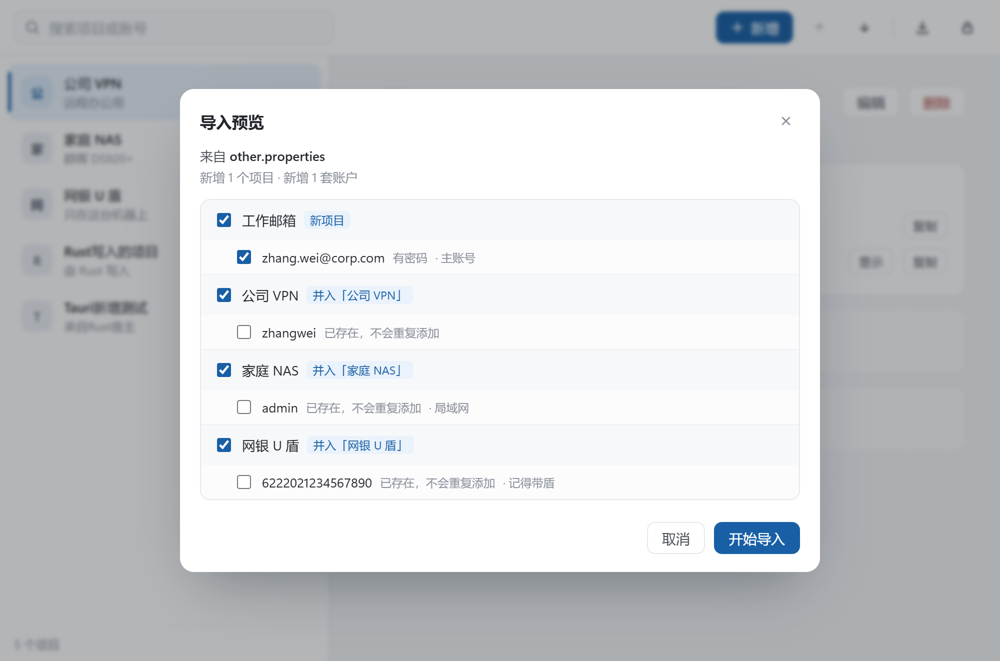
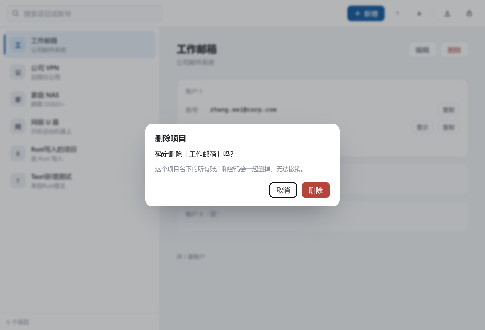

# SecBack

本地密码本。所有数据只存在这台机器上的一份加密文件里，不联网、不同步、无服务端。


## 特性

- **本地加密**：PBKDF2-HMAC-SHA256（20 万轮）+ AES-256-GCM，密钥不落盘
- **格式稳定**：64 字节明文头 + 密文负载，有独立的格式契约与测试向量，可跨实现互通
- **自动锁定**：闲置 5 分钟擦掉内存密钥并回到登录页
- **跨机器导入**：两台机器的密库取并集，幂等——同一个文件反复导入不会产生重复
- **便携**：密库跟着 exe 走，整个文件夹拷到 U 盘就能用
- **深色 / 浅色主题**：默认深色，菜单「外观」可切
- **不持有明文**：界面只拿到"这套账户有密码"的布尔值，点"显示"才单独取一次

| 导入预览 | 删除确认 |
|---|---|
|  |  |

## 技术架构

```
core/        纯 Rust 核心：加密、格式、读写、合并（不依赖任何 GUI，可跨端复用）
src/         前端：原生 HTML/CSS/JS，无构建步骤
src-tauri/   Tauri 2 宿主：命令分发、菜单、剪贴板、闲置看门狗
```

界面用系统 WebView2 渲染，因此程序本身只有几 MB。

## 构建

需要 Rust（1.90+）、Node.js、MSVC 工具链。

```bash
# 核心测试（含与另一实现的逐字节对拍）
cd core && cargo test

# 桌面应用
npm install
npx tauri build              # 产出安装包
npx tauri build --no-bundle  # 只出 exe
```

产物在 `src-tauri/target/release/`。

## 密库位置

按顺序决定：`SECBACK_VAULT` 环境变量 → exe 同目录 `secback.cfg` 的 `vault=` → exe 同目录 `sec.properties`。

配置模板见 [`delivery/secback.cfg`](delivery/secback.cfg)。路径写错时程序会拒绝进入而不是退回默认——
免得用户在错误的位置新建空库，以为原来的数据丢了。

## 开发提示

调试界面时用 CDP 驱动，比注入 JS 可靠：

```bash
WEBVIEW2_ADDITIONAL_BROWSER_ARGUMENTS='--remote-debugging-port=9222' ./secback.exe
node _cdp.mjs out.png "document.querySelectorAll('.item').length"
```

## 声明

个人工具，无服务端、无遥测。密库一旦遗失或忘记主密码，无法恢复——这是设计如此。
